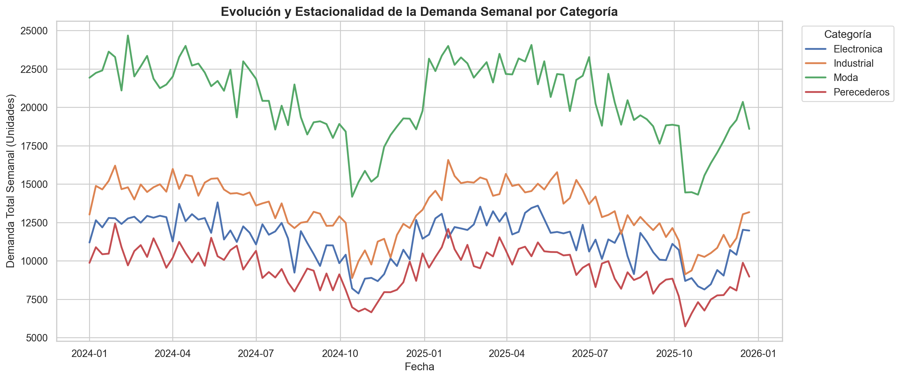

# Demand Planning & Inventory Optimization | Supply Chain Portfolio

## 📊 Project Overview
This project addresses the operational and financial challenges of managing high demand volatility and seasonality (specifically the **October demand drop vs. December peak surge**) across a synthetic multi-category retail/industrial dataset of 50 SKUs over 104 weeks. 

Moving beyond basic diagnostic dashboards, this project implements a **predictive and prescriptive modeling approach** in Python to optimize safety stocks, protect working capital, and mitigate stockout risks under real-world constraints.

## 📈 Visual Diagnostics: Seasonality and "Moment 0"
This graphic shows the synchronized drop in demand in October and the critical rebound toward december:

  

---

## 🛠️ Methodological Framework (Addendum)
1. **Quantitative EDA & Seasonality Diagnosis:** Visualizing synchronized volume drops and holiday spikes across categories (Electronics, Industrial, Fashion, Perishables).
2. **Risk & Capital Quantification:** Evaluating static vs. dynamic safety stock requirements based on service-level targets ($Z$-score) and annualized holding cost rates (18%).
3. **Predictive Modeling (Python/Pandas):** Generating monthly demand profiles to transition from static assumptions to seasonal-aware reordering.
4. **C-Level Financial Impact Assessment:** Translating supply chain adjustments into working capital optimization and cash-flow protection.

---

## 📁 Repository Structure

demand-planning-inventory-optimization/
│
├── data/
│   └── demand_inventory_data.csv       # 5,200 rows of synthetic SKU-level weekly demand
│
├── notebooks/
│   ├── generate_data.py                  # Dataset simulation script
│   └── 01_demand_planning_eda.ipynb      # EDA, metrics, and predictive profiling
│
└── README.md                             # Executive documentation

## 🚀 Key Operational Insights
* **The October Fallacy:** Recognizing that demand drops in October are not a market contraction, but the critical lead-time window required to pre-position inventory for the December peak.
* **Working Capital vs. Stockout Risk:** Balancing the tension between conservative inventory buffering and financial constraints (treasury limits and warehouse capacity).